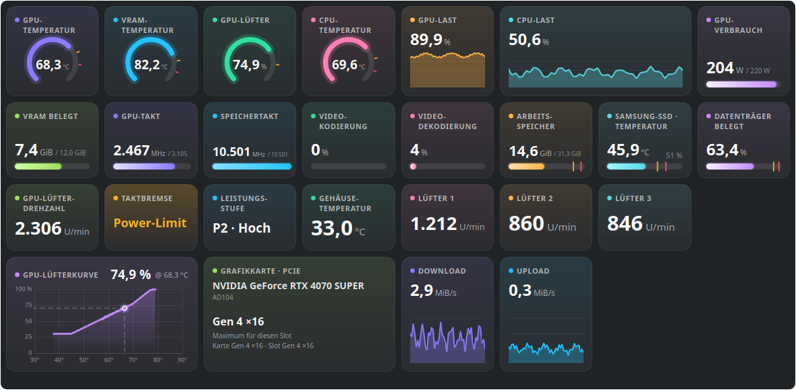

# Sensor Deck

*[English](README.md)*

Ein **GPU- & System-Monitor** für **KDE Plasma 6**: VRAM-Temperatur, Taktbremse, PCIe-Verbindung
und eine selbstlernende Lüfterkurve – dazu Prozessor, Arbeitsspeicher, SSDs und Lüfter, als Ringe, Balken und Graphen.



<table>
  <tr>
    <td width="50%"><br><sub>Zwei Grafikkarten: je Karte ein Abschnitt plus Vergleichskacheln</sub></td>
    <td width="50%"><br><sub>Folgt dem Plasma-Farbschema (hier Breeze Hell)</sub></td>
  </tr>
  <tr>
    <td><br><sub>Einrichtungsassistent mit Hardware-Erkennung</sub></td>
    <td valign="top"><sub>Die Bilder zeigen simulierte Werte.</sub></td>
  </tr>
</table>

## Funktionen

- **Ringe, Balken, Verlaufsgraphen und reine Werte** – pro Kachel, per Rechtsklick änderbar
- **Grafikkarten**: Temperatur, Hotspot, VRAM-Temperatur, Last, Verbrauch, Takte,
  Video-Kodierung/-Dekodierung, Taktbremse, Leistungsstufe, PCIe-Verbindung
  (inkl. ob Karte oder Slot begrenzt) – NVIDIA über `nvidia-smi`, AMD/Intel über ksystemstats
- **Mehrere Grafikkarten**: je Karte ein farbig markierter Abschnitt, Vergleichskacheln
- **Lüfterkurve**, die aus echten Messwerten lernt und Neustarts übersteht
- **Gemessene GPU-Lüfterdrehzahl** (U/min, je Lüfter) – steht ein Lüfter still, obwohl die Karte ihn braucht, wird die Kachel rot und es kommt eine Benachrichtigung
- **System**: Prozessor, Arbeitsspeicher, SSD-Temperaturen, Speicherplatz, Mainboard-Lüfter und -Temperatur, Netzwerk
- **Einrichtungsassistent** mit Hardware-Erkennung sowie Layout-Vorlagen, die anzeigen, ob sie verändert wurden
- **Desktop-Benachrichtigungen** bei kritischen Werten
- **Verständliche Tooltips**, die erklären, was ein Wert bedeutet und ob er normal ist
- **Profile**: die aktuelle Ansicht (Kacheln, Darstellung, Benachrichtigungen) unter einem Namen speichern, per Rechtsklick wechseln,
  als Datei exportieren und importieren – Befehle in importierten Profilen werden vor dem Speichern angezeigt
- **Kacheln direkt im Widget bearbeiten** (Rechtsklick → *Kacheln bearbeiten*): ziehen zum Verschieben, × zum Entfernen, + zum Hinzufügen aus Vorschlägen für die eigene Hardware

## Installation

**Am einfachsten – ohne Terminal:** Rechtsklick auf den Desktop → **Widgets hinzufügen** →
**Neue Widgets holen** → **Neue Plasma-Widgets herunterladen**, nach „Sensor Deck“ suchen und
*Installieren* klicken. Updates kommen dann über Discover.

**Als Paket** von der [Release-Seite](https://github.com/Paderman/kde-plasma-widget-sensordeck/releases)
(Doppelklick öffnet die Softwareverwaltung): `.deb` für Kubuntu/KDE neon/Debian/Mint,
`.rpm` für Fedora/openSUSE, PKGBUILD für Arch, `.plasmoid` für jedes Plasma-6-System.

**Aus dem Quellcode:**

```bash
git clone https://github.com/Paderman/kde-plasma-widget-sensordeck.git
cd kde-plasma-widget-sensordeck
./install.sh
```

Danach: Rechtsklick auf den Desktop oder eine Kontrollleiste → **Widgets hinzufügen** → **Sensor Deck**.

### VRAM-Temperatur von NVIDIA-Karten (optional)

```bash
pkexec ./gddr6-service/install-service.sh
```

Der Dienst läuft ohne Root-Rechte und ohne `/dev/mem`. Details stehen in der [englischen README](README.md).

### Stromverbrauch von Prozessor und integrierter Grafik (optional)

```bash
pkexec ./power-service/install-service.sh
```

Der Prozessor misst seinen Verbrauch selbst, der Kernel lässt diese Zähler aber
seit 2020 nur Root lesen – sehr häufig und sehr genau ausgelesen ermöglichen sie
einen Seitenkanal-Angriff („Platypus“). Der Dienst liest sie einmal pro Sekunde und
gibt **nur den Durchschnitt dieser Sekunde, gerundet auf 0,1 W** weiter: viel zu grob
für einen Angriff, genau genug für die Anzeige. Er läuft wie der VRAM-Dienst ohne
Root-Rechte. Entfernen: `pkexec ./power-service/uninstall-service.sh`.

## Hardware

Prozessor, Arbeitsspeicher, SSDs und Netzwerk funktionieren auf allen Systemen, NVIDIA-Karten
mit dem offiziellen Treiber vollständig. AMD- und Intel-Grafik werden unterstützt, sind aber
noch nicht auf echter Hardware getestet. **Mainboard-Lüfter** brauchen einen Treiber für den
Sensorchip des Mainboards. Fehlen sie, bietet der Einrichtungsassistent einen Button
„Sensor-Unterstützung installieren“ an – ohne Terminal, nur mit Passwortabfrage. Viele Gigabyte-Boards brauchen zusätzlich den
[it87-Treiber](https://github.com/frankcrawford/it87). Details in der [englischen README](README.md#mainboard-sensors).

Fehlt etwas auf der eigenen Hardware? Dann bitte `./tools/hardware-report.sh` ausführen und die
erzeugte Datei an einen
[Hardware-Bericht](https://github.com/Paderman/kde-plasma-widget-sensordeck/issues/new?template=hardware_report.yml) anhängen.

## Updates

Sensor Deck fragt einmal, ob es wöchentlich nach neuen Versionen suchen darf (standardmäßig aus).
Dabei wird nur `api.github.com` nach der neuesten Versionsnummer gefragt – GitHub sieht die
IP-Adresse wie bei jedem Website-Besuch, sonst wird nichts gesendet. Manuell geht es jederzeit
unter *Einrichten → Info & Updates → Jetzt prüfen*.

## Sprachen

Englisch (Originalsprache), Deutsch, Französisch, Spanisch, Italienisch, Portugiesisch (Brasilien),
Niederländisch, Polnisch, Russisch, Ukrainisch, Japanisch und Chinesisch (vereinfacht).
Außer Deutsch sind die Übersetzungen maschinell unterstützt erstellt – Korrekturen sind willkommen
(Dateien in `translate/`).

## Hilfe & Fehler melden

<https://github.com/Paderman/kde-plasma-widget-sensordeck/issues>

## Lizenz

Copyright © 2026 Paderman – GNU General Public License, Version 2 oder neuer. Siehe [LICENSE](LICENSE).
