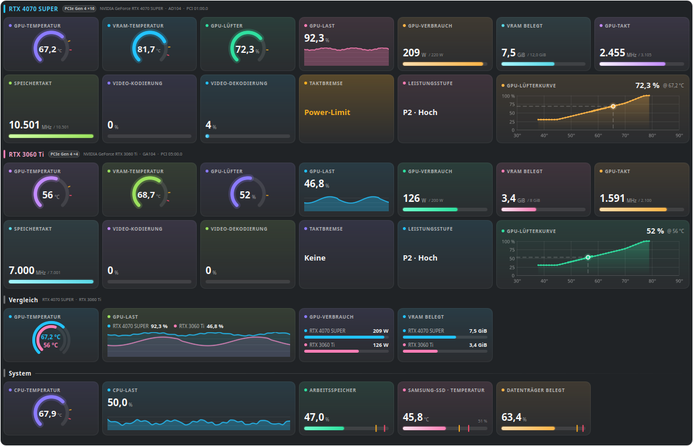
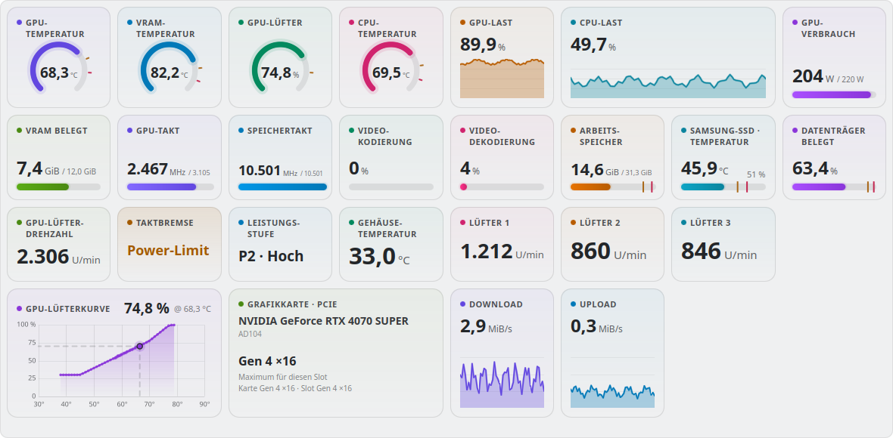
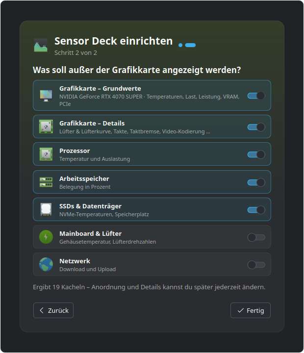

# Sensor Deck

*[English version](README.md)*

Ein **GPU- & System-Monitor** als Widget für **KDE Plasma 6**: VRAM-Temperatur, Taktbremse,
PCIe-Verbindung und eine selbstlernende Lüfterkurve – dazu Prozessor, Arbeitsspeicher, SSDs und Lüfter,
als Ringe, Balken und Verlaufsgraphen.


<table>
  <tr>
    <td width="50%"><br><sub>Zwei Grafikkarten: je Karte ein Abschnitt plus Vergleichskacheln</sub></td>
    <td width="50%"><br><sub>Folgt dem Plasma-Farbschema (hier Breeze Hell)</sub></td>
  </tr>
  <tr>
    <td><br><sub>Einrichtungsassistent mit Hardware-Erkennung</sub></td>
    <td valign="top"><sub>Die Bilder zeigen simulierte Werte, erzeugt mit
    <code>tools/screenshots/make-screenshots.sh</code>.</sub></td>
  </tr>
</table>

## Funktionen

- **Ringe, Balken, Verlaufsgraphen und reine Werte** – pro Kachel, per Rechtsklick änderbar
- **Grafikkarten**: Temperatur, Hotspot, VRAM-Temperatur, Last, Verbrauch, Takte,
  Video-Kodierung/-Dekodierung, Grund der Taktbremse, Leistungsstufe, PCIe-Verbindung
  (inkl. ob Karte oder Slot begrenzt) – NVIDIA über `nvidia-smi`, AMD/Intel über ksystemstats
- **Mehrere Grafikkarten**: je Karte ein farbig markierter Abschnitt, Vergleichskacheln
- **Lüfterkurve**, die aus echten Messwerten lernt und Neustarts übersteht
- **Gemessene GPU-Lüfterdrehzahl** (U/min, je Lüfter) – steht ein Lüfter still, obwohl die Karte ihn
  braucht, wird die Kachel rot; dreht er deutlich langsamer als die anderen, gelb – jeweils mit einer Benachrichtigung
- **System**: Prozessor, Arbeitsspeicher (belegt / gesamt, Swap im Tooltip), SSD-Temperaturen,
  Speicherplatz, Mainboard-Lüfter und -Temperatur, Netzwerk
- **Einrichtungsassistent** mit Hardware-Erkennung sowie Layout-Vorlagen
  („Systemübersicht“, „GPU-Fokus“, „Alle Grafikkarten“), die anzeigen, ob sie verändert wurden
- **Desktop-Benachrichtigungen** bei kritischen Werten (Verzögerung, Hysterese, Pause)
- **Verständliche Tooltips**, die erklären, was ein Wert bedeutet und ob er normal ist
- **Kacheln direkt im Widget bearbeiten** (Rechtsklick → *Kacheln bearbeiten*): ziehen zum Verschieben,
  × zum Entfernen, + zum Hinzufügen aus Vorschlägen für die erkannte Hardware
- **Profile**: die aktuelle Ansicht (Kacheln, Darstellung, Benachrichtigungen) unter einem Namen speichern,
  per Rechtsklick wechseln, als Datei exportieren und importieren – Befehle in importierten Profilen
  werden vor dem Speichern angezeigt
- Passt sich der Widget-Größe an, Leisten-Modus mit Mini-Ringen

## Voraussetzungen

- KDE Plasma 6 mit **ksystemstats** (Teil von Plasma)
- Optional: `nvidia-smi` (NVIDIA-Treiber) für die ausführlichen NVIDIA-Werte und `python3` für die
  gemessene Lüfterdrehzahl von NVIDIA-Karten (aus der Treiberbibliothek, nur Standardbibliothek)
- Optional: `lm-sensors` (`sensors`, für Lüfternamen aus `sensors.conf` und `sensors-detect`) und
  `pciutils` (`lspci`, für die Namen der Grafikkarten)
- Optional: `gettext`, um bei der Installation aus dem Quellcode die Übersetzungen zu erzeugen

## Installation

**Am einfachsten – ohne Terminal** *(sobald Sensor Deck im KDE Store ist – noch nicht)*: Rechtsklick auf den Desktop → **Widgets hinzufügen** →
**Neue Widgets holen** → **Neue Plasma-Widgets herunterladen**, nach „Sensor Deck“ suchen und
*Installieren* klicken. Updates kommen dann über Discover.

**Als Paket** von der [Release-Seite](https://github.com/Paderman/kde-plasma-widget-sensordeck/releases)
(Doppelklick öffnet die Softwareverwaltung):

| System | Datei |
|---|---|
| Kubuntu, KDE neon, Debian, Linux Mint | `plasma-widget-sensordeck_<version>_all.deb` |
| Fedora KDE, openSUSE | `plasma-widget-sensordeck-<version>-1.noarch.rpm` |
| Arch, Manjaro, EndeavourOS, CachyOS | `packaging/arch/PKGBUILD` (AUR) |
| jedes Plasma-6-System | `sensordeck-<version>.plasmoid` – *Widgets hinzufügen → Neue Widgets holen → Aus lokaler Datei installieren* |

Ein Paket installiert das Widget für alle Benutzer. Wurde es zusätzlich aus dem Quellcode für den
eigenen Benutzer installiert, hat diese Kopie Vorrang – sie lässt sich mit dem Befehl unten entfernen.

**Aus dem Quellcode:**

```bash
git clone https://github.com/Paderman/kde-plasma-widget-sensordeck.git
cd kde-plasma-widget-sensordeck
./install.sh
```

Danach: Rechtsklick auf den Desktop oder eine Kontrollleiste → **Widgets hinzufügen** → **Sensor Deck**.
Nach einem Update Plasma neu laden: `systemctl --user restart plasma-plasmashell`.

Entfernen: `kpackagetool6 -t Plasma/Applet -r io.github.paderman.sensordeck`

### VRAM-Temperatur von NVIDIA-Karten (optional)

`nvidia-smi` meldet die Speichertemperatur (VRAM) von GeForce-Karten nicht.
Der kleine Dienst in [`gddr6-service/`](gddr6-service) liest sie aus dem Registerfenster der Karte
(`/sys/bus/pci/devices/<addr>/resource0`) – **ohne Root-Rechte und ohne `/dev/mem`**: Er läuft als
eigener Systembenutzer, der nur diese eine Datei lesen darf.

```bash
pkexec ./gddr6-service/install-service.sh     # installieren und starten
pkexec ./gddr6-service/uninstall-service.sh   # wieder entfernen
```

Unterstützt werden GDDR6/GDDR6X-Karten, deren Register bekannt ist (z. B. RTX-30- und RTX-40-Serie).
AMD-Karten melden die VRAM-Temperatur selbst (`amdgpu … mem`), dort ist kein Dienst nötig.

### Stromverbrauch von Prozessor und integrierter Grafik (optional)

Der Prozessor misst seinen Verbrauch selbst (RAPL), der Kernel lässt diese Zähler aber seit 2020
nur Root lesen: Sehr häufig und sehr genau ausgelesen ermöglichen sie einen Seitenkanal-Angriff
([CVE-2020-8694](https://platypusattack.com/), „Platypus“). Der Dienst in
[`power-service/`](power-service) liest sie einmal pro Sekunde und gibt **nur den Durchschnitt
dieser Sekunde, gerundet auf 0,1 W** weiter – viel zu grob für einen solchen Angriff, genau genug für
die Anzeige. Wie der VRAM-Dienst läuft er als eigener Systembenutzer ohne Root-Rechte; nur dieser
Benutzer darf die Zähler lesen.

```bash
pkexec ./power-service/install-service.sh     # installieren und starten
pkexec ./power-service/uninstall-service.sh   # wieder entfernen (stellt den reinen Root-Zugriff wieder her)
```

Er liefert die Kacheln *CPU-Verbrauch* und – bei Intel-Grafik im Prozessor – *GPU-Verbrauch*.
Funktioniert mit Intel-Prozessoren und den meisten AMD-Ryzen-Prozessoren (nur der ganze Prozessor).

## Hardware-Unterstützung

| Bereich | Stand |
|---|---|
| Prozessor-Temperatur und -Last | Intel und AMD – über ksystemstats |
| Arbeitsspeicher, SSDs (NVMe), Speicherplatz, Netzwerk | alle Systeme |
| NVIDIA-Grafikkarten | vollständig mit dem proprietären Treiber (`nvidia-smi`); mit `nouveau` nur Grundwerte |
| AMD-Grafikkarten (`amdgpu`) | Temperatur, Hotspot und VRAM-Temperatur vom Kernel – *noch nicht auf echter Hardware getestet* |
| Intel-Grafik (`i915`/`xe`) | wird erkannt, wenige Werte – *noch nicht auf echter Hardware getestet* |
| Mainboard-Lüfter und Gehäusetemperatur | hängt vom Sensorchip des Mainboards ab, siehe unten |

Bisher wurde Sensor Deck nur auf einem PC getestet (ASUS-Z370-Board, RTX 3080).
**Fehlt etwas auf der eigenen Hardware, hilft ein
[Hardware-Bericht](https://github.com/Paderman/kde-plasma-widget-sensordeck/issues/new?template=hardware_report.yml)
sehr weiter:**

```bash
./tools/hardware-report.sh    # erzeugt sensordeck-hardware-report.md – bitte an das Issue anhängen
```

### Mainboard-Sensoren

Lüfter und Gehäusetemperatur stammen vom Sensorchip des Mainboards
(z. B. Nuvoton `nct67xx`, ITE `it87xx`, Fintek `f71xxx`) oder von der Firmware des Laptops
(`thinkpad`, `dell_smm`, …). Linux braucht dafür einen Treiber für diesen Chip.

Die Schritte 1 und 2 kann der Einrichtungsassistent übernehmen (Knopf *Sensor-Unterstützung
installieren* – dabei wird das Passwort abgefragt). Von Hand:

1. lm-sensors installieren (Debian/Ubuntu: `lm-sensors`, Fedora/Arch: `lm_sensors`, openSUSE: `sensors`).
2. Einmal `sudo sensors-detect` ausführen, die Fragen mit den Vorgaben beantworten und die Module
   eintragen lassen. Neu starten.
3. Mit `sensors` prüfen, ob Lüfter erscheinen, dann den Einrichtungsassistenten erneut starten
   (Rechtsklick auf das Widget → *Sensor Deck einrichten …* → *Einrichtungsassistent starten*).

Bekannte zusätzliche Treiber:
- **Viele Gigabyte-Boards** (ITE-Chips IT8686/IT8688/IT8689): Der `it87`-Treiber im Kernel kennt sie
  oft nicht – Abhilfe schafft der gepflegte
  [it87-Treiber außerhalb des Kernels](https://github.com/frankcrawford/it87).
  Ohne ihn zeigt `gigabyte_wmi` nur Temperaturen, keine Lüfter.
- **ASUS-Boards**: `asus-ec-sensors` (neuere ROG-/TUF-/ProArt-Boards) ergänzt Chipsatz, Spannungswandler (VRM)
  und weitere Lüftersensoren; `asus_wmi_sensors` deckt einige ältere Modelle ab.
- **Manche Boards** brauchen den Kernel-Parameter `acpi_enforce_resources=lax`, bevor der Treiber
  `nct6775`/`it87` laden darf – nur verwenden, wenn `sensors-detect` oder `dmesg` es nahelegen.

Lüfter lassen sich in `/etc/sensors.d/*.conf` umbenennen (`label fan1 "CPU-Lüfter"`) – benannte Lüfter
werden dann immer angeboten, auch wenn sie gerade stillstehen.

## Übersetzungen

Das Widget ist auf Englisch geschrieben und wird mit gettext übersetzt:

| Sprache | Datei | | Sprache | Datei |
|---|---|---|---|---|
| Deutsch | `translate/de.po` | | Polnisch | `translate/pl.po` |
| Französisch | `translate/fr.po` | | Russisch | `translate/ru.po` |
| Spanisch | `translate/es.po` | | Ukrainisch | `translate/uk.po` |
| Italienisch | `translate/it.po` | | Japanisch | `translate/ja.po` |
| Portugiesisch (Brasilien) | `translate/pt_BR.po` | | Chinesisch (vereinfacht) | `translate/zh_CN.po` |
| Niederländisch | `translate/nl.po` | | | |

Deutsch pflegt der Autor selbst. Die übrigen Sprachen sind maschinell unterstützt entstanden und
wurden noch nicht von Muttersprachlern geprüft – Korrekturen sind sehr willkommen, ebenso neue Sprachen:

```bash
./translate/extract.sh            # translate/template.pot und alle .po-Dateien aktualisieren
cp translate/template.pot translate/xx.po   # neue Sprache beginnen (xx = Sprachcode)
./translate/build.sh              # übersetzen – install.sh erledigt das automatisch
```

## Updates

Sensor Deck fragt einmal, ob es nach neuen Versionen suchen darf (wöchentlich, standardmäßig aus).
Mit Zustimmung wird nur `api.github.com` nach der neuesten Versionsnummer gefragt – GitHub sieht dabei
die IP-Adresse wie bei jedem Website-Besuch; sonst wird nichts gesendet und keine Statistik geführt.
Von Hand geht es jederzeit unter *Sensor Deck einrichten … → Info & Updates → Jetzt prüfen*, auch ohne der
automatischen Prüfung zuzustimmen.

## Pakete bauen

| Befehl | Ergebnis in `dist/` |
|---|---|
| `./make-package.sh` | `sensordeck-<version>.plasmoid` (KDE Store, „Aus lokaler Datei installieren“) |
| `packaging/deb/build-deb.sh` | `.deb` (braucht `dpkg-deb`, `fakeroot`) |
| `packaging/rpm/build-rpm.sh` | `.rpm` (braucht `rpmbuild`) |
| `packaging/arch/PKGBUILD` | Arch-Paket (`makepkg`) / AUR |

Screenshots: `tools/screenshots/make-screenshots.sh` erzeugt `docs/screenshots/*.png` mit simulierter
Hardware in einem unsichtbaren X-Server (braucht `xvfb-run`, `plasmoidviewer`, `node`, `python3-polib`).
Das eigene Widget und seine Einstellungen bleiben unberührt.

Veröffentlichen: die Version in `package/metadata.json` **und** `package/contents/ui/UpdateCheck.js`
setzen (`tools/check-version.sh` prüft beides), dann einen Tag `v<version>` pushen. Der GitHub-Workflow
`.github/workflows/release.yml` baut `.plasmoid`, `.deb` und `.rpm` und hängt sie an einen
Release-Entwurf.

## Hilfe & Fehler melden

Bitte ein Issue eröffnen: <https://github.com/Paderman/kde-plasma-widget-sensordeck/issues>

## Danksagung

Die Register-Adressen für die VRAM-Temperatur von NVIDIA-Karten folgen den Untersuchungen des
Projekts [gddr6](https://github.com/olealgoritme/gddr6). Dessen Code ist nicht enthalten (das Projekt
hat keine Lizenz); verwendet werden nur die dokumentierten Fakten über die Register.

## Lizenz

Copyright © 2026 Paderman

Dieses Programm ist freie Software; es darf unter den Bedingungen der GNU General Public License,
wie von der Free Software Foundation veröffentlicht, weitergegeben und/oder verändert werden –
entweder gemäß Version 2 der Lizenz oder (nach Wahl) jeder späteren Version.
Siehe [LICENSE](LICENSE) (verbindlich ist der englische Lizenztext).
