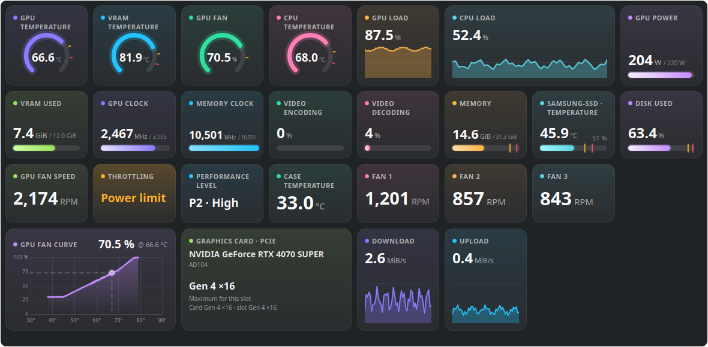
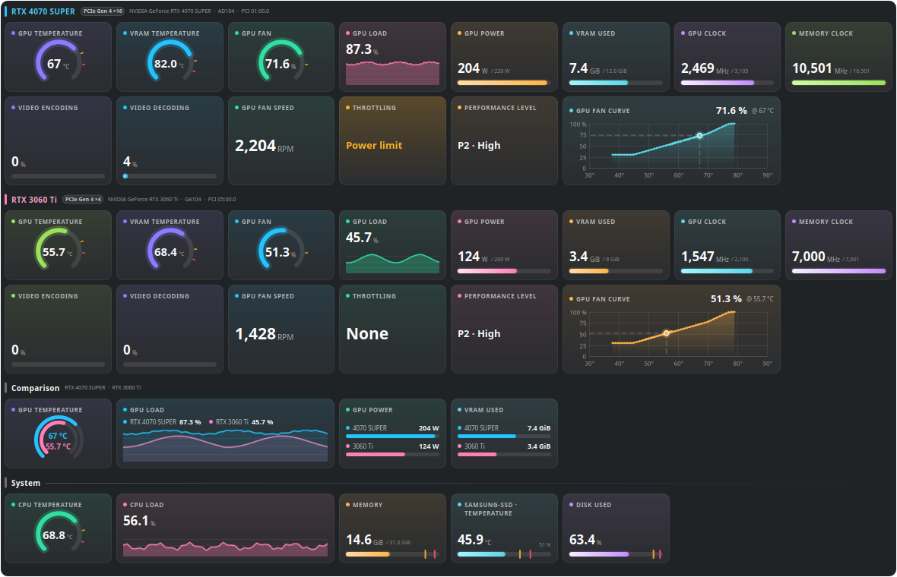
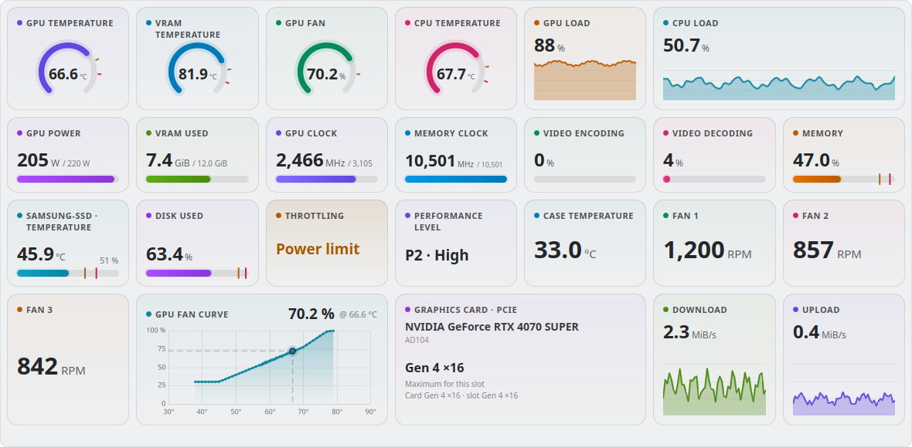
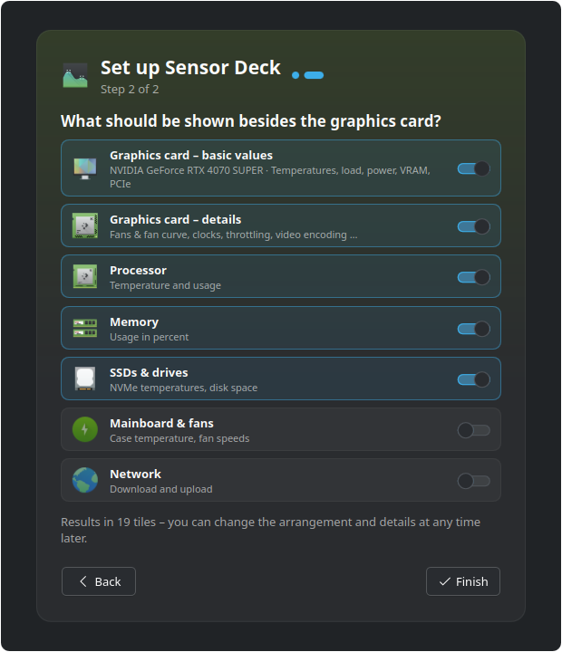

# Sensor Deck

*[Deutsch](README.de.md)*

A **GPU & system monitor** widget for **KDE Plasma 6**: VRAM temperature, throttling,
PCIe link and a self-learning fan curve – plus CPU, memory, SSDs and fans, as rings, bars and graphs.



<table>
  <tr>
    <td width="50%"><br><sub>Two graphics cards: one section per card plus comparison tiles</sub></td>
    <td width="50%"><br><sub>Follows the Plasma colour scheme (here Breeze Light)</sub></td>
  </tr>
  <tr>
    <td><br><sub>Setup wizard with hardware detection</sub></td>
    <td valign="top"><sub>Screenshots show simulated values, rendered with
    <code>tools/screenshots/make-screenshots.sh</code>.</sub></td>
  </tr>
</table>

## Features

- **Rings, bars, history graphs and plain values** – per tile, changeable with a right-click
- **Graphics cards**: temperature, hotspot, VRAM temperature, load, power, clocks,
  video encoder/decoder, throttling reason, performance level, PCIe link
  (incl. whether card or slot limits it) – NVIDIA via `nvidia-smi`, AMD/Intel via ksystemstats
- **Several graphics cards**: one colour-coded section per card, comparison tiles
- **Fan curve** that learns from real measurements and is kept across restarts
- **Measured GPU fan speeds** (RPM, per fan) – the tile turns red and notifies once if a fan stands still although the card wants it to turn
- **System**: CPU, memory, SSD temperatures, disk usage, mainboard fans and temperature, network
- **Setup wizard** that detects your hardware, plus layout templates
  (“System overview”, “GPU focus”, “All graphics cards”) that show whether you changed them
- **Desktop notifications** for critical values (delay, hysteresis, cooldown)
- **Plain-language tooltips** that explain what a value means and whether it is normal
- **Edit tiles right in the widget** (right-click → *Edit tiles*): drag to move, × to remove, + to add from suggestions for your hardware
- **Profiles**: save the current view (tiles, appearance, notifications) under a name, switch with a right-click,
  export and import them as a file – commands in imported profiles are shown before anything is stored
- Fits itself to the widget size, panel mode with mini rings

## Requirements

- KDE Plasma 6 with **ksystemstats** (part of Plasma)
- Optional: `nvidia-smi` (NVIDIA driver) for the detailed NVIDIA values, and `python3` for the
  measured fan speeds of NVIDIA cards (read from the driver library, standard library only)
- Optional: `lm-sensors` (`sensors`, for fan names from `sensors.conf` and `sensors-detect`) and
  `pciutils` (`lspci`, for graphics card names)
- Optional: `gettext` to build the translations when installing from source

## Installation

**Easiest – without a terminal:** right-click the desktop → **Add Widgets** →
**Get New Widgets** → **Download New Plasma Widgets**, search for “Sensor Deck” and click
*Install*. Updates then come through Discover.

**As a package** from the [releases page](https://github.com/Paderman/kde-plasma-widget-sensordeck/releases)
(double-click opens your software center):

| System | File |
|---|---|
| Kubuntu, KDE neon, Debian, Linux Mint | `plasma-widget-sensordeck_<version>_all.deb` |
| Fedora KDE, openSUSE | `plasma-widget-sensordeck-<version>-1.noarch.rpm` |
| Arch, Manjaro, EndeavourOS, CachyOS | `packaging/arch/PKGBUILD` (AUR) |
| any Plasma 6 system | `sensordeck-<version>.plasmoid` – *Add Widgets → Get New Widgets → Install from local file* |

A package installs the widget for all users. If you also installed it from source for
your user, that copy takes precedence – remove it with the command below.

**From source:**

```bash
git clone https://github.com/Paderman/kde-plasma-widget-sensordeck.git
cd kde-plasma-widget-sensordeck
./install.sh
```

Then right-click the desktop or a panel → **Add Widgets** → **Sensor Deck**.
After an update, reload Plasma with `systemctl --user restart plasma-plasmashell`.

To remove it: `kpackagetool6 -t Plasma/Applet -r io.github.paderman.sensordeck`

### VRAM temperature of NVIDIA cards (optional)

`nvidia-smi` does not report the memory (VRAM) temperature of GeForce cards.
The small service in [`gddr6-service/`](gddr6-service) reads it from the card's
register window (`/sys/bus/pci/devices/<addr>/resource0`) – **without root and
without `/dev/mem`**: it runs as a throw-away system user with read access to
that one file only.

```bash
pkexec ./gddr6-service/install-service.sh     # install and start
pkexec ./gddr6-service/uninstall-service.sh   # remove again
```

Supported are GDDR6/GDDR6X cards whose register is known (e.g. RTX 30/40 series).
AMD cards report the VRAM temperature themselves (`amdgpu … mem`), no service needed.

### Power draw of the processor and built-in graphics (optional)

The processor measures its own power draw (RAPL), but since 2020 the kernel lets
only root read these counters: read very often and very precisely they allow a
side-channel attack ([CVE-2020-8694](https://platypusattack.com/), “Platypus”).
The service in [`power-service/`](power-service) reads them once per second and
publishes **only the average of that second, rounded to 0.1 W** – far too coarse
for such an attack, precise enough for a monitor. Like the VRAM service it runs as
a throw-away system user without root; only that user gets read access to the
counters.

```bash
pkexec ./power-service/install-service.sh     # install and start
pkexec ./power-service/uninstall-service.sh   # remove again (restores root-only access)
```

It provides the tiles *CPU power* and – for Intel graphics built into the
processor – *GPU power*. Works with Intel processors and most AMD Ryzen
processors (whole processor only).

## Hardware support

| Area | Status |
|---|---|
| CPU temperature and load | Intel and AMD – via ksystemstats |
| Memory, SSDs (NVMe), disk usage, network | all systems |
| NVIDIA graphics cards | full detail with the proprietary driver (`nvidia-smi`); `nouveau` only basic values |
| AMD graphics cards (`amdgpu`) | temperature, hotspot and VRAM temperature from the kernel – *not yet tested on real hardware* |
| Intel graphics (`i915`/`xe`) | detected, few values – *not yet tested on real hardware* |
| Mainboard fans and case temperature | depends on the mainboard's sensor chip, see below |

So far Sensor Deck has been tested on one PC only (ASUS Z370 board, RTX 3080).
**If something is missing on your hardware, please send a
[hardware report](https://github.com/Paderman/kde-plasma-widget-sensordeck/issues/new?template=hardware_report.yml)**:

```bash
./tools/hardware-report.sh    # writes sensordeck-hardware-report.md – attach it to the issue
```

### Mainboard sensors

Fans and the case temperature come from the sensor chip on the mainboard
(e.g. Nuvoton `nct67xx`, ITE `it87xx`, Fintek `f71xxx`) or from the laptop's
firmware (`thinkpad`, `dell_smm`, …). Linux needs a driver for that chip:

The setup wizard can do steps 1 and 2 for you (button *Install sensor support* – you are
asked for your password). By hand:

1. Install lm-sensors (Debian/Ubuntu: `lm-sensors`, Fedora/Arch: `lm_sensors`, openSUSE: `sensors`).
2. Run `sudo sensors-detect` once, answer the questions with the defaults and
   let it add the modules. Restart.
3. Check with `sensors` that fans appear, then run the setup wizard again
   (right-click the widget → *Configure* → *Setup wizard*).

Known extra drivers:
- **Many Gigabyte boards** (ITE IT8686/IT8688/IT8689 chips): the `it87` driver in the
  kernel often does not know them – use the maintained
  [out-of-tree it87 driver](https://github.com/frankcrawford/it87).
  Without it, `gigabyte_wmi` shows temperatures only, no fans.
- **ASUS boards**: `asus-ec-sensors` (newer ROG/TUF/ProArt boards) adds chipset, VRM and
  extra fan sensors; `asus_wmi_sensors` covers some older models.
- **Some boards** need the kernel parameter `acpi_enforce_resources=lax` before the
  `nct6775`/`it87` driver may load – only use it if `sensors-detect` or `dmesg` suggests it.

You can rename fans in `/etc/sensors.d/*.conf` (`label fan1 "CPU fan"`) – named fans are
then always offered, even while they stand still.

## Translations

The widget is written in English and translated with gettext:

| Language | File | | Language | File |
|---|---|---|---|---|
| German | `translate/de.po` | | Polish | `translate/pl.po` |
| French | `translate/fr.po` | | Russian | `translate/ru.po` |
| Spanish | `translate/es.po` | | Ukrainian | `translate/uk.po` |
| Italian | `translate/it.po` | | Japanese | `translate/ja.po` |
| Portuguese (Brazil) | `translate/pt_BR.po` | | Chinese (Simplified) | `translate/zh_CN.po` |
| Dutch | `translate/nl.po` | | | |

German is maintained by the author. The other languages were created with machine
assistance and have not yet been reviewed by native speakers – corrections are very
welcome, as are new languages:

```bash
./translate/extract.sh            # update translate/template.pot and all .po files
cp translate/template.pot translate/xx.po   # start a new language (xx = language code)
./translate/build.sh              # compile – install.sh does this automatically
```

## Updates

Sensor Deck asks once whether it may look for new versions (weekly, off by default).
If you agree, it asks `api.github.com` for the newest version number – GitHub sees your
IP address as with any website visit; nothing else is sent, no statistics are kept.
You can also check by hand under *Configure → About & updates → Check now*, without
agreeing to the automatic check.

## Packaging

| Command | Result in `dist/` |
|---|---|
| `./make-package.sh` | `sensordeck-<version>.plasmoid` (KDE Store, “Install from local file”) |
| `packaging/deb/build-deb.sh` | `.deb` (needs `dpkg-deb`, `fakeroot`) |
| `packaging/rpm/build-rpm.sh` | `.rpm` (needs `rpmbuild`) |
| `packaging/arch/PKGBUILD` | Arch package (`makepkg`) / AUR |

Screenshots: `tools/screenshots/make-screenshots.sh` renders `docs/screenshots/*.png` with
simulated hardware in an invisible X server (needs `xvfb-run`, `plasmoidviewer`, `node`,
`python3-polib`). Your own widget and settings are not touched.

Releasing: set the version in `package/metadata.json` **and** `package/contents/ui/UpdateCheck.js`
(`tools/check-version.sh` checks both), then push a tag `v<version>`. The GitHub workflow
`.github/workflows/release.yml` builds `.plasmoid`, `.deb` and `.rpm` and attaches them to a
draft release.

## Help & bug reports

Please open an issue: <https://github.com/Paderman/kde-plasma-widget-sensordeck/issues>

## Credits

The register offsets for the NVIDIA VRAM temperature follow the research of the
[gddr6](https://github.com/olealgoritme/gddr6) project. Its code is not included
(the project has no licence); only the documented register facts are used.

## Licence

Copyright © 2026 Paderman

This program is free software; you can redistribute it and/or modify it under the
terms of the GNU General Public License as published by the Free Software
Foundation; either version 2 of the License, or (at your option) any later version.
See [LICENSE](LICENSE).
